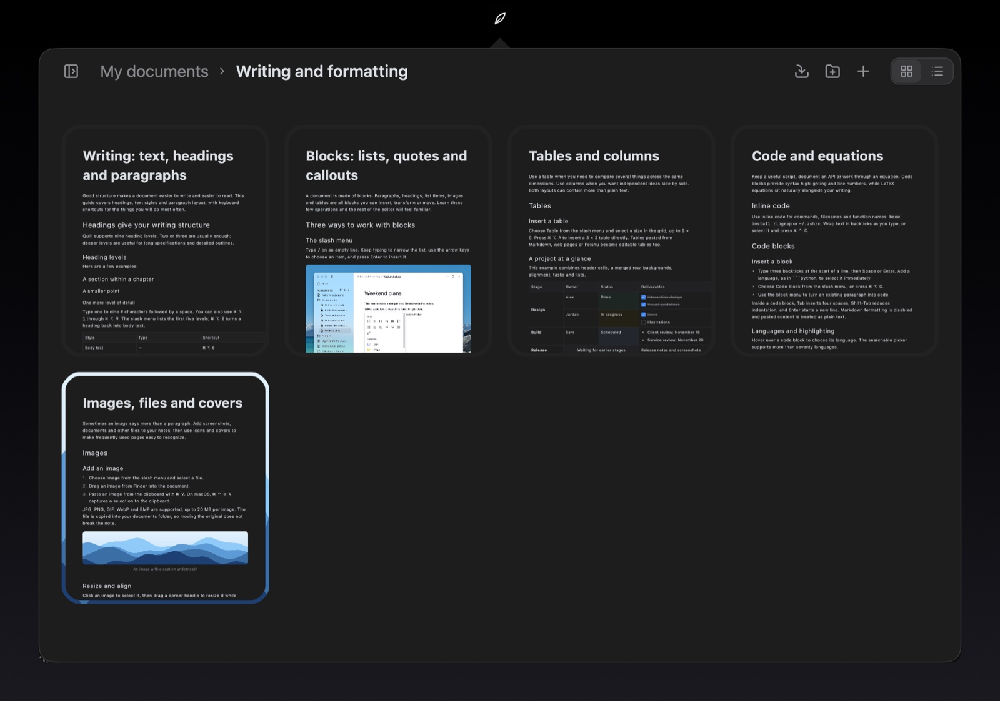
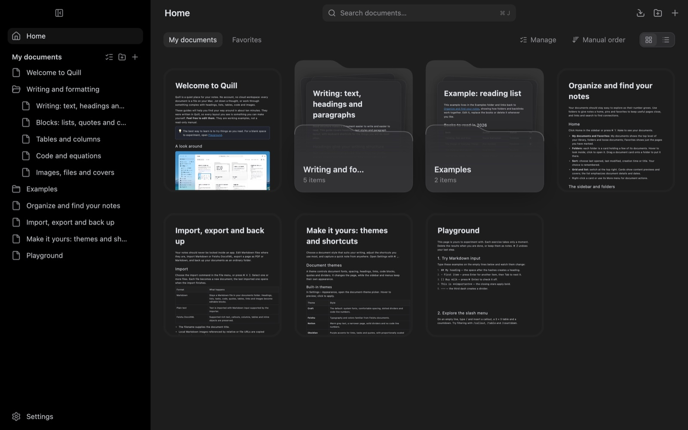
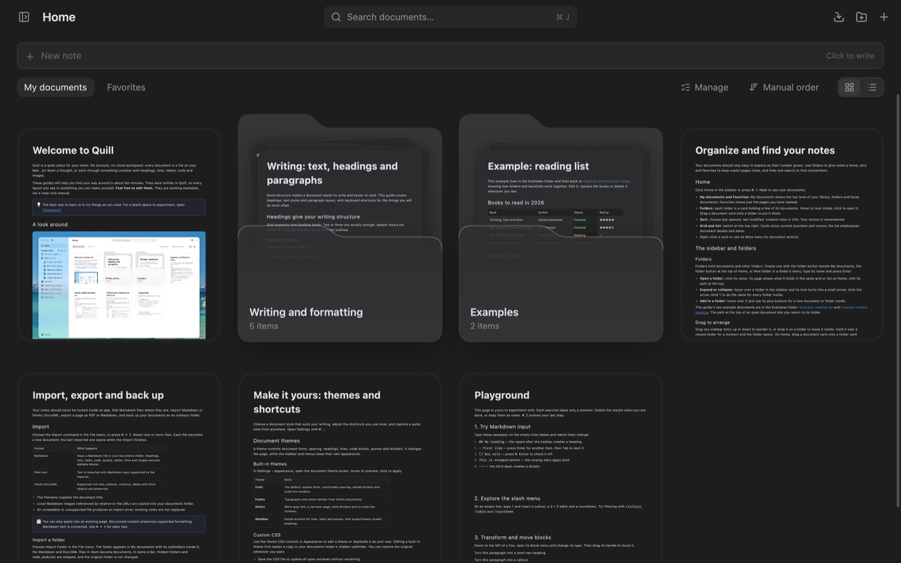
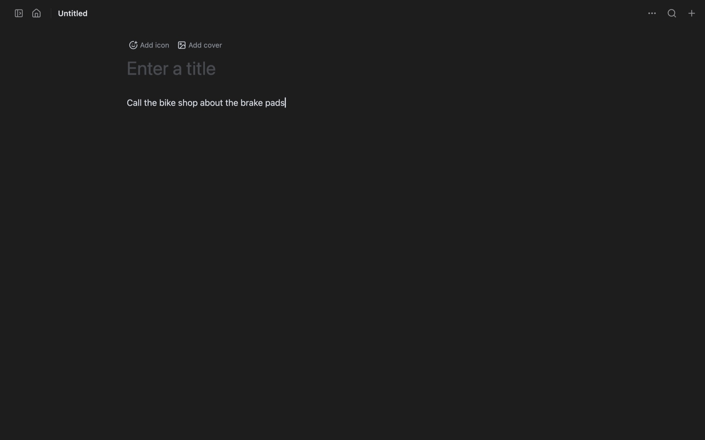
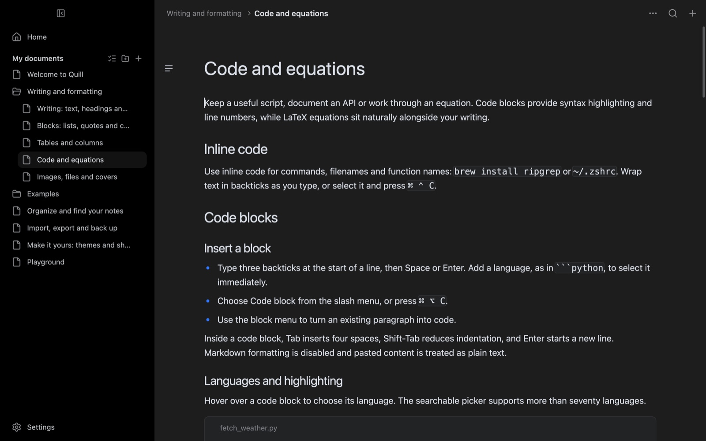

<h1 align="center">Quill</h1>

<p align="center">
  <b>Local notes that live in your Mac's menu bar.</b><br>
  Click the feather, start writing. Every note is a file on your Mac.
</p>

<p align="center">
  
  
  <a href="LICENSE"></a>
  
</p>

<p align="center">
  
</p>

Quill is a fork of [Quiet.md](https://github.com/s1dashu/quiet-md), a fast native notes app written in Rust with [GPUI](https://www.gpui.rs/). It keeps every Quiet.md feature and adds a home in the menu bar: one click on the feather opens your notes under the icon, and a **New note** field on top of Home turns into a fresh note as soon as you click it.

## Two ways to open Quill

**From the menu bar.** Quill puts a feather in the menu bar while it runs. Click it to open the menu bar window right under the icon; click anywhere else, press Esc or click the feather again to put it away (your note is saved first). This window is set up for quick capture: no sidebar at first, and a New note field at the top of Home. Right-click the feather for New Note, Open Window, Settings and Quit.

**As a standard window.** Open Quill from Applications, the Dock or Spotlight and you get a normal, resizable window with the sidebar, exactly like Quiet.md. Both can be open at the same time and show the same library: a note edited in one appears in the other.

The Dock icon shows only while a standard window is open. With just the menu bar window, Quill stays out of the Dock and the app switcher.

<p align="center">
  
</p>

## A new note in one click

At the top of Home in the menu bar window sits a **New note** field. Click it and it grows into a full editor while Home slides out of the bottom. What you type becomes the note's first line. Press Esc on an empty note and it shrinks back into the field without leaving an empty file behind. With Reduce Motion turned on in macOS, the slide becomes a short cross-fade.

<p align="center">
  
  
</p>

## Everything from Quiet.md

<p align="center">
  
</p>

- **A full rich-text editor**: headings, lists, to-dos, quotes, callouts, columns, tables with merged cells, code blocks with syntax highlighting, LaTeX math, images, attachments and covers. Markdown shortcuts such as `#`, `-`, `[]` and `>`, and a `/` menu for everything else.
- **Organizing**: nested folders, pinning, favorites, full-text search (`⌘ J`) and a trash.
- **Import and export**: Markdown and Feishu (Lark) DocxXML in, Markdown and PDF out, or print. Local Markdown files can be edited in place.
- **Themes**: Craft, Feishu, Notion and Obsidian styles, each with a dark look, or your own CSS ([docs/THEMES.md](docs/THEMES.md)).
- **Shortcuts**: `⌘ /` lists them all, and every one can be rebound.
- **Fast**: the whole interface is drawn on the GPU. No WebView, no Electron, no background services.
- **Getting started guide**: a new library starts with a short tour of the main features. Existing notes are never overwritten.

The interface is available in English and Simplified Chinese.

## Global shortcuts

| Shortcut | What it does |
|---|---|
| `⌥ Space` | Quick note window from anywhere |
| `⌘ ⌥ Space` | Open the last used document |
| Not set | Show or hide the menu bar window (set it in **Settings > Shortcuts > Global**) |

**Settings > General > Launch at login** starts Quill with just the menu bar icon when you log in.

## Your notes are files

Quill keeps its library in `~/Documents/Quill`, an ordinary folder you can see, back up and sync with any tool you like. Each note is one XML file in the DocxXML format. No account, no cloud, and nothing goes over the network unless a note shows a web image (that can be turned off in **Settings > General**). Quill has its own library and settings, so it can run next to Quiet.md without the two touching each other's notes.

The storage format is described in [docs/FORMAT.md](docs/FORMAT.md).

## Build from source

Requirements: macOS 13 or later, the Xcode Command Line Tools, [rustup](https://rustup.rs) (the Rust version is pinned in `rust-toolchain.toml`), and Apple's Metal toolchain for GPUI's shaders:

```bash
xcodebuild -downloadComponent MetalToolchain
```

Then build and run against a scratch library, so your real notes are never touched:

```bash
cargo build --release --locked
```

```bash
QUILL_HOME=/tmp/quill-lib ./target/release/quill
```

Run the tests and clippy before committing:

```bash
scripts/check.sh
```

`scripts/package.sh` builds, signs and notarizes `Quill.app` into a `.dmg`; `scripts/release.sh` makes a signed ZIP. Both need a Developer ID certificate. More detail on the code and the tools is in [CONTRIBUTING.md](CONTRIBUTING.md) and [docs/ARCHITECTURE.md](docs/ARCHITECTURE.md).

## How it is built

Quill's specs, questions and decisions are tracked on a [Spill](.spill/SPILL.md) board in `.spill/`. Upstream's own README and notes are kept in [docs/upstream](docs/upstream/README.md), and the `upstream` git remote points at Quiet.md so its fixes can be merged in.

## License

MIT, inherited from Quiet.md: see [LICENSE](LICENSE). Third-party code, fonts and assets are listed in [THIRD_PARTY.md](THIRD_PARTY.md).

Quill has its own name, app icon and menu bar icon, and uses [Lucide](https://lucide.dev) icons (ISC). The Quiet.md name, its app icon and its Nucleo icons are not used.
